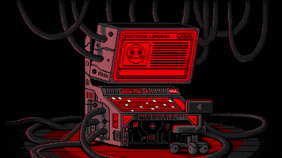
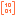
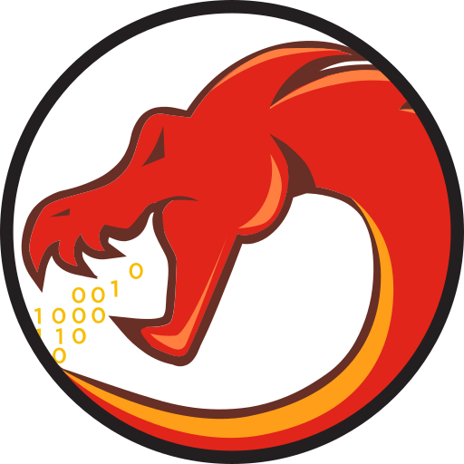
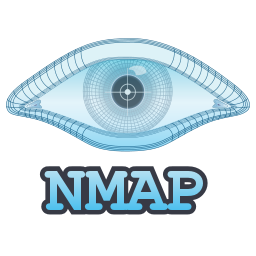

<h3 align="center">Inspect My Work </h3>

  
  
  

  
  
  

###

  

###

<h3 align="center">Arsenal</h3>

  <!-- Languages & Frameworks -->
  
  
  
  
  
  
  
  
  
  
  
  
  
  
  
  
  
  
  
  
  

  <!-- Reverse Engineering, Systems & Security Tools -->
  
  
  
  
  
  
  
  
  
  
  
  
  
  
  
  
  
  
  
  
  

###

  

